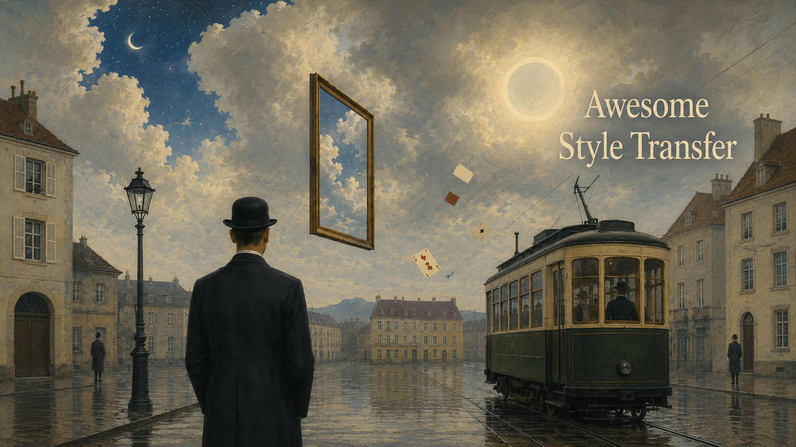
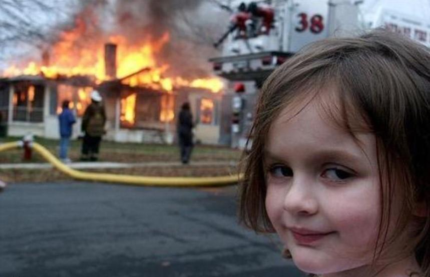
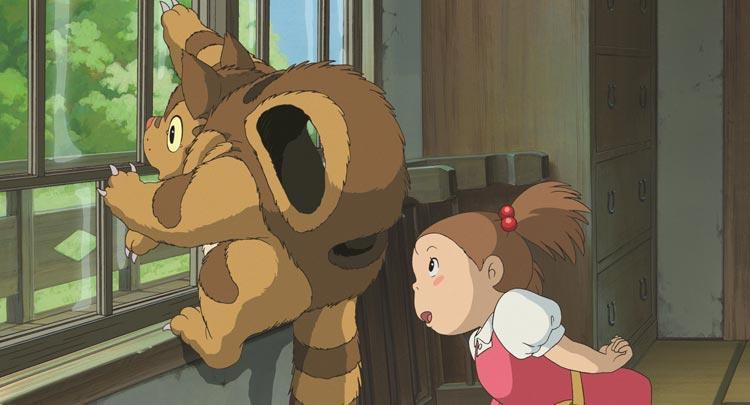
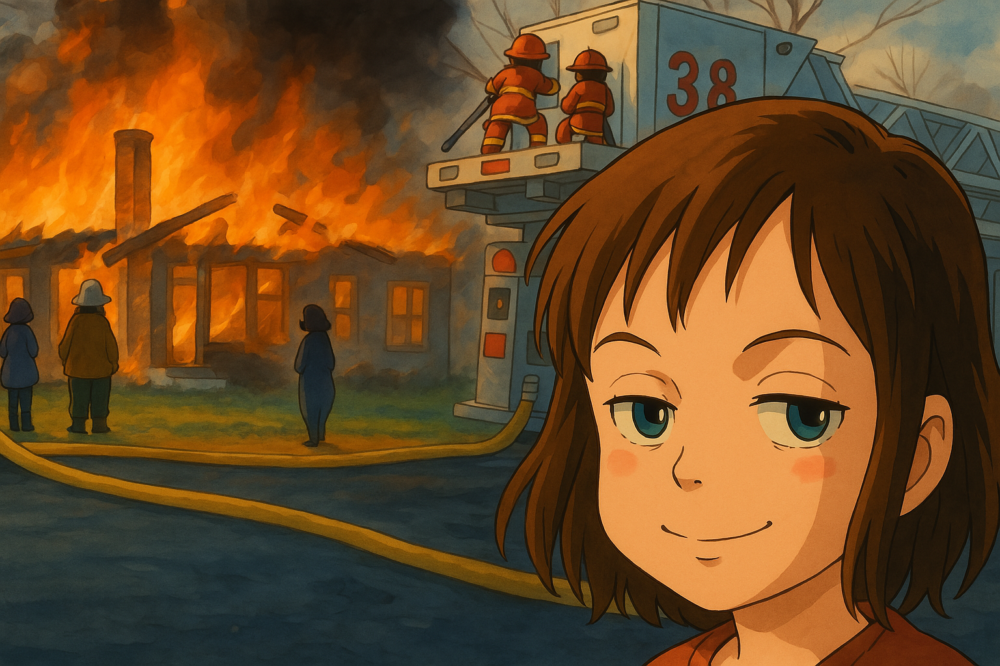
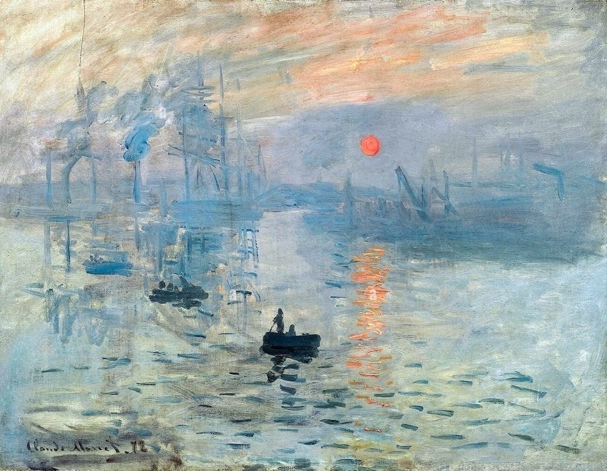

<div align="center">

# 🎨 Awesome Style Transfer

<p align="center">
  
</p>

[](https://awesome.re)
[](https://github.com/neptune-T/Awesome-Style-Transfer)
[](https://github.com/neptune-T/Awesome-Style-Transfer)
[](https://github.com/neptune-T/Awesome-Style-Transfer)
[](https://opensource.org/licenses/MIT)
[](https://github.com/neptune-T/Awesome-Style-Transfer)

<p align="center">
    <a href="#taxonomy">Taxonomy</a> |
    <a href="#papers">Papers</a> |
    <a href="#coverage">Coverage</a> |
    <a href="#comparison-axes">F1–F3</a> |
    <a href="#datasets">Datasets</a> |
    <a href="#contributing">Contributing</a>
</p>

</div>

## 🎨 About This Repository

A curated collection of **style transfer** research papers spanning **🖼️ 2D image, 🎬 video, 🧊 3D (NeRF / mesh / point cloud / 3DGS) and ⏳ 4D (dynamic scene) stylization**, organized by the **Style-Carrier Taxonomy** from our survey *Style Transfer: A Decade Survey*.

Representative methods are also compared along three axes: **F1 · reuse**, **F2 · selective binding** and **F3 · consistency** (see [F1–F3](#comparison-axes)).

> **Domain tags:** 🖼️ Image · 🎬 Video · 🧊 3D · ⏳ 4D · 🌐 Multiple

## 🖼️ Style Transfer Examples

<div align="center">
<table>
  <tr>
    <th>Content Image</th>
    <th>Style Image</th>
    <th>Transferred Result</th>
  </tr>
  <tr>
    <td></td>
    <td></td>
    <td></td>
  </tr>
  <tr>
    <td><em>Disaster Girl</em></td>
    <td><em>となりのトトロ</em></td>
    <td><em>Transferred Result</em></td>
  </tr>
</table>
</div>

<a id="taxonomy"></a>

## 🧭 The Style-Carrier Taxonomy

<div align="center">

| Carrier | Core idea | Anchors | Papers |
|---------|-----------|---------|:------:|
| **[🎯 Style as Optimization Objective](#objective)** | Style is applied through a loss, score, or guidance objective. | *Gatys et al. · ARF* | **31** |
| **[🧩 Style as Feature Operator](#feature)** | Style acts through feature matching, replacement, transport, or attention coupling. | *AdaIN · WCT* | **62** |
| **[⚙️ Style as Model Parameters](#parameter)** | Style is stored in reusable weights, LoRA updates, or learned tokens. | *Johnson et al. · LoRA* | **30** |
| **[🔌 Style as Learned Condition](#condition)** | A reference is encoded into a condition for a shared generator. | *Ghiasi et al. · IP-Adapter* | **33** |

</div>

A paper may appear under more than one carrier.

<a id="coverage"></a>

## 📊 Coverage at a Glance

<div align="center">

| Carrier | 🖼️ Image | 🎬 Video | 🧊 3D | ⏳ 4D |
|---------|:------:|:------:|:---:|:---:|
| 🎯 Optimization Objective | 10 | 2 | 16 | 3 |
| 🧩 Feature Operator | 45 | 7 | 8 | 4 |
| ⚙️ Model Parameters | 23 | 5 | 1 | 1 |
| 🔌 Learned Condition | 24 | 4 | 7 | — |

</div>

> 🌐 Papers are counted in each applicable domain.

## 📑 Table of Contents

1. [🎯 Style as Optimization Objective](#objective) — 31 papers
2. [🧩 Style as Feature Operator](#feature) — 62 papers
3. [⚙️ Style as Model Parameters](#parameter) — 30 papers
4. [🔌 Style as Learned Condition](#condition) — 33 papers
5. [Related Papers](#related) — 62 papers
6. [📖 Surveys](#surveys) — 7 papers
7. [📏 Evaluation Metrics and Benchmarks](#evaluation) — 17 papers
8. [🏗️ Generative Backbones](#backbones) — 8 papers
9. [🗃️ Dataset Papers](#dataset-papers) — 7 papers
10. [🧪 F1–F3 Comparison Axes](#comparison-axes)
11. [📚 Datasets](#datasets)
12. [🤝 Contributing](#contributing)

<a id="papers"></a>

## 🗂️ Papers by Style Carrier

<a id="objective"></a>

### 1. 🎯 Style as Optimization Objective

*Style is applied through a loss, score, or guidance objective.*

| Paper | Venue | Year | Rep | Link |
|-------|-------|:----:|:---:|------|
| A neural algorithm of artistic style | arXiv | 2015 | 🖼️ | [paper](https://arxiv.org/pdf/1508.06576v2) |
| Artistic Style Transfer for Videos | GCPR | 2016 | 🎬 | [paper](https://arxiv.org/pdf/1604.08610v2) |
| Deep photo style transfer | CVPR | 2017 | 🖼️ | [paper](https://arxiv.org/abs/1703.07511) |
| Arbitrary Style Transfer with Deep Feature Reshuffle | CVPR | 2018 | 🖼️ | [paper](https://openaccess.thecvf.com/content_cvpr_2018/html/Gu_Arbitrary_Style_Transfer_CVPR_2018_paper.html) |
| Artistic Style Transfer for Videos and Spherical Images | IJCV | 2018 | 🎬 | [paper](https://arxiv.org/abs/1708.04538) |
| Style transfer by relaxed optimal transport and self-similarity | CVPR | 2019 | 🖼️ | [paper](https://arxiv.org/abs/1904.12785) |
| Arf: Artistic radiance fields | ECCV | 2022 | 🧊 | [paper](https://arxiv.org/pdf/2206.06360) |
| CLIPstyler: Image style transfer with a single text condition | CVPR | 2022 | 🖼️ | [paper](https://arxiv.org/abs/2112.00374) |
| SNeRF: Stylized neural implicit representations for 3D scenes | ACM TOG | 2022 | 🧊 | [paper](https://arxiv.org/pdf/2207.02363v1) |
| StyleMesh: Style transfer for indoor 3D scene reconstructions | CVPR | 2022 | 🧊 | [paper](https://arxiv.org/abs/2112.01530) |
| Diffusion-based image translation using disentangled style and content representation | ICLR | 2023 | 🖼️ | [paper](https://arxiv.org/abs/2209.15264) |
| Ref-NPR: Reference-Based Non-Photorealistic Radiance Fields for Controllable Scene Stylization | CVPR | 2023 | 🧊 | [paper](https://arxiv.org/abs/2212.02766) |
| Transforming Radiance Field With Lipschitz Network for Photorealistic 3D Scene Stylization | CVPR | 2023 | 🧊 | [paper](https://openaccess.thecvf.com/content/CVPR2023/papers/Zhang_Transforming_Radiance_Field_With_Lipschitz_Network_for_Photorealistic_3D_Scene_CVPR_2023_paper.pdf) |
| 3D Paintbrush: Local Stylization of 3D Shapes with Cascaded Score Distillation | CVPR | 2024 | 🧊 | [paper](https://arxiv.org/abs/2311.09571) |
| Controllable Style Transfer via Test-time Training of Implicit Neural Representation | Pattern Recognition | 2024 | 🖼️ | [paper](https://arxiv.org/abs/2210.07762) |
| NeRF-Art: Text-Driven Neural Radiance Fields Stylization | TVCG | 2024 | 🧊 | [paper](https://arxiv.org/abs/2212.08070) |
| S-DyRF: Reference-Based Stylized Radiance Fields for Dynamic Scenes | CVPR | 2024 | ⏳ | [paper](https://arxiv.org/pdf/2403.06205v3) |
| Balanced image stylization with style matching score | ICCV | 2025 | 🖼️ | [paper](https://arxiv.org/abs/2503.07601) |
| GAS-NeRF: Geometry-Aware Stylization of Dynamic Radiance Fields | arXiv | 2025 | ⏳ | [paper](https://arxiv.org/pdf/2503.08483v1) |
| Geometry in Style: 3D Stylization via Surface Normal Deformation | CVPR | 2025 | 🧊 | [paper](https://openaccess.thecvf.com/content/CVPR2025/html/Dinh_Geometry_in_Style_3D_Stylization_via_Surface_Normal_Deformation_CVPR_2025_paper.html) |
| Morpheus: Text-Driven 3D Gaussian Splat Shape and Color Stylization | CVPR | 2025 | 🧊 | [paper](https://arxiv.org/abs/2503.02009) |
| SGSST: Scaling Gaussian Splatting Style Transfer | CVPR | 2025 | 🧊 | [paper](https://arxiv.org/abs/2412.03371) |
| Stylizedgs: Controllable stylization for 3d gaussian splatting | TPAMI | 2025 | 🧊 | [paper](https://arxiv.org/abs/2404.05220) |
| Tune-Your-Style: Intensity-tunable 3D Style Transfer with Gaussian Splatting | ICCV | 2025 | 🧊 | [paper](https://arxiv.org/abs/2602.00618) |
| CLeaR: A Unified Framework for Resolving the Leakage--Degradation Dilemma in Style Transfer | arXiv | 2026 | 🖼️ | [paper](https://arxiv.org/abs/2609.38136) |
| DiffStyle3D: Consistent 3D Gaussian Stylization via Attention Optimization | ICML | 2026 | 🧊 | [paper](https://arxiv.org/abs/2601.19717) |
| Fantasystyle: Controllable stylized distillation for 3d gaussian splatting | AAAI | 2026 | 🧊 | [paper](https://arxiv.org/abs/2508.08136) |
| Geometry-Aware Style Transfer in 3D Gaussian Splatting | ECCV | 2026 | 🧊 | [paper](https://arxiv.org/html/2606.24144) |
| GT2-GS: Geometry-aware Texture Transfer for Gaussian Splatting | AAAI | 2026 | 🧊 | [paper](https://arxiv.org/abs/2505.15208) |
| Style4D-Bench: A Benchmark Suite for 4D Stylization | AAAI | 2026 | ⏳ | [paper](https://arxiv.org/pdf/2508.19243v1) |
| StyleGallery: Training-free and Semantic-aware Personalized Style Transfer from Arbitrary Image References | CVPR | 2026 | 🖼️ | [paper](https://arxiv.org/abs/2603.10354) |

<a id="feature"></a>

### 2. 🧩 Style as Feature Operator

*Style acts through feature matching, replacement, transport, or attention coupling.*

| Paper | Venue | Year | Rep | Link |
|-------|-------|:----:|:---:|------|
| Arbitrary style transfer in real-time with adaptive instance normalization | ICCV | 2017 | 🖼️ | [paper](https://arxiv.org/pdf/1703.06868v2) |
| Universal style transfer via feature transforms | NeurIPS | 2017 | 🖼️ | [paper](https://arxiv.org/pdf/1705.08086v2) |
| A closed-form solution to photorealistic image stylization | ECCV | 2018 | 🖼️ | [paper](https://arxiv.org/abs/1802.06474) |
| Avatar-net: Multi-scale zero-shot style transfer by feature decoration | CVPR | 2018 | 🖼️ | [paper](https://arxiv.org/abs/1805.03857) |
| Arbitrary Style Transfer with Style-Attentional Networks | CVPR | 2019 | 🖼️ | [paper](https://arxiv.org/abs/1812.02342) |
| Content and Style Disentanglement for Artistic Style Transfer | ICCV | 2019 | 🖼️ | [paper](https://openaccess.thecvf.com/content_ICCV_2019/html/Kotovenko_Content_and_Style_Disentanglement_for_Artistic_Style_Transfer_ICCV_2019_paper.html) |
| Learning linear transformations for fast image and video style transfer | CVPR | 2019 | 🌐 | [paper](https://arxiv.org/pdf/1808.04537v1) |
| Photorealistic style transfer via wavelet transforms | ICCV | 2019 | 🖼️ | [paper](https://arxiv.org/abs/1903.09760) |
| AdaAttN: Revisit attention mechanism in arbitrary neural style transfer | ICCV | 2021 | 🖼️ | [paper](https://arxiv.org/abs/2108.03647) |
| Arbitrary video style transfer via multi-channel correlation | AAAI | 2021 | 🎬 | [paper](https://arxiv.org/pdf/2009.08003v2) |
| Artflow: Unbiased image style transfer via reversible neural flows | CVPR | 2021 | 🖼️ | [paper](https://arxiv.org/pdf/2103.16877v2) |
| CCPL: Contrastive coherence preserving loss for versatile style transfer | ECCV | 2022 | 🌐 | [paper](https://arxiv.org/pdf/2207.04808v4) |
| Domain enhanced arbitrary image style transfer via contrastive learning | SIGGRAPH | 2022 | 🖼️ | [paper](https://arxiv.org/abs/2205.09542) |
| Exact feature distribution matching for arbitrary style transfer and domain generalization | CVPR | 2022 | 🖼️ | [paper](https://arxiv.org/abs/2203.07740) |
| Stytr2: Image style transfer with transformers | CVPR | 2022 | 🖼️ | [paper](https://arxiv.org/abs/2105.14576) |
| UPST-NeRF: Universal Photorealistic Style Transfer of Neural Radiance Fields for 3D Scene | arXiv | 2022 | 🧊 | [paper](https://arxiv.org/pdf/2208.07059v2) |
| A Unified Arbitrary Style Transfer Framework via Adaptive Contrastive Learning | ACM TOG | 2023 | 🖼️ | [paper](https://arxiv.org/abs/2303.12710) |
| AesPA-Net: Aesthetic Pattern-Aware Style Transfer Networks | ICCV | 2023 | 🖼️ | [paper](https://arxiv.org/abs/2307.09724) |
| CAP-VSTNet: Content affinity preserved versatile style transfer | CVPR | 2023 | 🖼️ | [paper](https://arxiv.org/abs/2303.17867) |
| StyleRF: Zero-Shot 3D Style Transfer of Neural Radiance Fields | CVPR | 2023 | 🧊 | [paper](https://openaccess.thecvf.com/content/CVPR2023/papers/Liu_StyleRF_Zero-Shot_3D_Style_Transfer_of_Neural_Radiance_Fields_CVPR_2023_paper.pdf) |
| AesFA: An Aesthetic Feature-Aware Arbitrary Neural Style Transfer | AAAI | 2024 | 🖼️ | [paper](https://arxiv.org/abs/2312.05928) |
| Ctrl-x: Controlling structure and appearance for text-to-image generation without guidance | NeurIPS | 2024 | 🖼️ | [paper](https://arxiv.org/abs/2406.07540) |
| DiffStyler: Diffusion-based Localized Image Style Transfer | arXiv | 2024 | 🖼️ | [paper](https://arxiv.org/abs/2403.18461) |
| FPRF: Feed-Forward Photorealistic Style Transfer of Large-Scale 3D Neural Radiance Fields | AAAI | 2024 | 🧊 | [paper](https://ojs.aaai.org/index.php/AAAI/article/view/28054) |
| G3DST: Generalizing 3D Style Transfer with Neural Radiance Fields across Scenes and Styles | GCPR | 2024 | 🧊 | [paper](https://arxiv.org/pdf/2408.13508v1) |
| InstantStyle: Free Lunch towards Style-Preserving in Text-to-Image Generation | arXiv | 2024 | 🖼️ | [paper](https://arxiv.org/abs/2404.02733v2) |
| Puff-Net: Efficient Style Transfer with Pure Content and Style Feature Fusion Network | CVPR | 2024 | 🖼️ | [paper](https://arxiv.org/abs/2405.19775) |
| Rethink Arbitrary Style Transfer with Transformer and Contrastive Learning | CVIU | 2024 | 🖼️ | [paper](https://arxiv.org/abs/2404.13584) |
| S2WAT: Image Style Transfer via Hierarchical Vision Transformer Using Strips Window Attention | AAAI | 2024 | 🖼️ | [paper](https://arxiv.org/abs/2210.12381) |
| Style aligned image generation via shared attention | CVPR | 2024 | 🖼️ | [paper](https://arxiv.org/pdf/2312.02133v2) |
| Style injection in diffusion: A training-free approach for adapting large-scale diffusion models for style transfer | CVPR | 2024 | 🖼️ | [paper](https://arxiv.org/pdf/2312.09008v2) |
| StyleDyRF: Zero-shot 4D Style Transfer for Dynamic Neural Radiance Fields | arXiv | 2024 | ⏳ | [paper](https://arxiv.org/pdf/2403.08310v1) |
| StyleGaussian: Instant 3D Style Transfer with Gaussian Splatting | SIGASIA (Tech. Comm.) | 2024 | 🧊 | [paper](https://arxiv.org/pdf/2403.07807v1) |
| Z*: Zero-shot Style Transfer via Attention Reweighting | CVPR | 2024 | 🖼️ | [paper](https://openaccess.thecvf.com/content/CVPR2024/html/Deng_Z_Zero-shot_Style_Transfer_via_Attention_Reweighting_CVPR_2024_paper.html) |
| A3GS: Arbitrary Artistic Style into Arbitrary 3D Gaussian Splatting | ICCV | 2025 | 🧊 | [paper](https://openaccess.thecvf.com/content/ICCV2025/html/Fang_A3GS_Arbitrary_Artistic_Style_into_Arbitrary_3D_Gaussian_Splatting_ICCV_2025_paper.html) |
| AttenST: A Training-Free Attention-Driven Style Transfer Framework with Pre-Trained Diffusion Models | arXiv | 2025 | 🖼️ | [paper](https://arxiv.org/abs/2503.07307) |
| CSD-VAR: Content-Style Decomposition in Visual Autoregressive Models | ICCV | 2025 | 🖼️ | [paper](https://arxiv.org/abs/2507.13984) |
| D2Styler: Advancing Arbitrary Style Transfer with Discrete Diffusion Methods | ICPR | 2025 | 🖼️ | [paper](https://arxiv.org/abs/2408.03558) |
| DVI: Disentangling Semantic and Visual Identity for Training-Free Personalized Generation | arXiv | 2025 | 🖼️ | [paper](https://arxiv.org/abs/2512.18964) |
| FlowStyler: Artistic Video Stylization via Transformation Fields Transports | ICCV | 2025 | 🎬 | [paper](https://openaccess.thecvf.com/content/ICCV2025/html/Gong_FlowStyler_Artistic_Video_Stylization_via_Transformation_Fields_Transports_ICCV_2025_paper.html) |
| FreeViS: Training-free Video Stylization with Inconsistent References | arXiv | 2025 | 🎬 | [paper](https://arxiv.org/abs/2510.01686) |
| HSI: A Holistic Style Injector for Arbitrary Style Transfer | CVPR | 2025 | 🖼️ | [paper](https://arxiv.org/abs/2502.04369) |
| Only-Style: Stylistic Consistency in Image Generation without Content Leakage | ICCVW | 2025 | 🖼️ | [paper](https://arxiv.org/abs/2506.09916) |
| SaMam: Style-aware State Space Model for Arbitrary Image Style Transfer | CVPR | 2025 | 🖼️ | [paper](https://arxiv.org/abs/2503.15934) |
| SCSA: A Plug-and-Play Semantic Continuous-Sparse Attention for Arbitrary Semantic Style Transfer | CVPR | 2025 | 🖼️ | [paper](https://arxiv.org/abs/2503.04119) |
| SOYO: A Tuning-Free Approach for Video Style Morphing via Style-Adaptive Interpolation in Diffusion Models | arXiv | 2025 | 🎬 | [paper](https://arxiv.org/abs/2503.06998) |
| StyleKeeper: Prevent Content Leakage using Negative Visual Query Guidance | ICCV | 2025 | 🖼️ | [paper](https://arxiv.org/abs/2510.06827) |
| StyleSSP: Sampling StartPoint Enhancement for Training-free Diffusion-based Method for Style Transfer | CVPR | 2025 | 🖼️ | [paper](https://arxiv.org/abs/2501.11319) |
| StyleStudio: Text-Driven Style Transfer with Selective Control of Style Elements | CVPR | 2025 | 🖼️ | [paper](https://arxiv.org/pdf/2412.08503v2) |
| Towards 4D Human Video Stylization | CVIU | 2025 | ⏳ | [paper](https://arxiv.org/abs/2312.04143) |
| ZDySS: Zero-Shot Dynamic Scene Stylization using Gaussian Splatting | arXiv | 2025 | ⏳ | [paper](https://arxiv.org/abs/2501.03875v1) |
| 4DStyleGaussian: Generalizable 4D Style Transfer with Gaussian Splatting | Pattern Recognition | 2026 | ⏳ | [paper](https://arxiv.org/pdf/2410.10412v1) |
| A Training-Free Style-Personalization via SVD-Based Feature Decomposition | CVPR | 2026 | 🖼️ | [paper](https://openaccess.thecvf.com/content/CVPR2026/html/Lee_A_Training-Free_Style-Personalization_via_SVD-Based_Feature_Decomposition_CVPR_2026_paper.html) |
| CleanStyle: Plug-and-Play Style Conditioning Purification for Text-to-Image Stylization | arXiv | 2026 | 🖼️ | [paper](https://arxiv.org/abs/2602.20721) |
| CLeaR: A Unified Framework for Resolving the Leakage--Degradation Dilemma in Style Transfer | arXiv | 2026 | 🖼️ | [paper](https://arxiv.org/abs/2609.38136) |
| Disentangling Dual Image References in Frequency Aware Diffusion Models for Personalized Generation | arXiv | 2026 | 🖼️ | [paper](https://arxiv.org/abs/2610.07684) |
| FPGS: Feed-Forward Semantic-aware Photorealistic Style Transfer of Large-Scale Gaussian Splatting | IJCV | 2026 | 🧊 | [paper](https://arxiv.org/abs/2503.09635) |
| Kingfisher: Fast Personalized Visual Autoregressive Generation via Scale-Aware Prompt-Conditioned Scale Decomposition | arXiv | 2026 | 🖼️ | [paper](https://arxiv.org/abs/2610.23238) |
| Optimization-Free Style Transfer for 3D Gaussian Splats | WACV | 2026 | 🧊 | [paper](https://arxiv.org/abs/2508.05813) |
| SafeStyle: Calibrated Style Residual Injection for Controllable Style-Leakage Trade-off in Diffusion Stylization | arXiv | 2026 | 🖼️ | [paper](https://arxiv.org/abs/2609.21242) |
| StyleGallery: Training-free and Semantic-aware Personalized Style Transfer from Arbitrary Image References | CVPR | 2026 | 🖼️ | [paper](https://arxiv.org/abs/2603.10354) |
| UniVST: A Unified Framework for Training-free Localized Video Style Transfer | TPAMI | 2026 | 🎬 | [paper](https://arxiv.org/abs/2410.20084) |

<a id="parameter"></a>

### 3. ⚙️ Style as Model Parameters

*Style is stored in reusable weights, LoRA updates, or learned tokens.*

| Paper | Venue | Year | Rep | Link |
|-------|-------|:----:|:---:|------|
| Perceptual losses for real-time style transfer and super-resolution | ECCV | 2016 | 🖼️ | [paper](https://arxiv.org/pdf/1603.08155v1) |
| Texture networks: Feed-forward synthesis of textures and stylized images | ICML | 2016 | 🖼️ | [paper](https://arxiv.org/abs/1603.03417) |
| A Learned Representation for Artistic Style | ICLR | 2017 | 🖼️ | [paper](https://arxiv.org/abs/1610.07629) |
| Coherent online video style transfer | ICCV | 2017 | 🎬 | [paper](https://arxiv.org/pdf/1703.09211v2) |
| Real-time neural style transfer for videos | CVPR | 2017 | 🎬 | [paper](https://openaccess.thecvf.com/content_cvpr_2017/html/Huang_Real-Time_Neural_Style_CVPR_2017_paper.html) |
| Multi-style Generative Network for Real-time Transfer | ECCVW | 2018 | 🖼️ | [paper](https://arxiv.org/abs/1703.06953) |
| Neural Style Transfer via Meta Networks | CVPR | 2018 | 🖼️ | [paper](https://openaccess.thecvf.com/content_cvpr_2018/html/Shen_Neural_Style_Transfer_CVPR_2018_paper.html) |
| ReCoNet: Real-time coherent video style transfer network | ACCV | 2018 | 🎬 | [paper](https://arxiv.org/pdf/1807.01197v2) |
| Arf: Artistic radiance fields | ECCV | 2022 | 🧊 | [paper](https://arxiv.org/pdf/2206.06360) |
| Real-Time Portrait Stylization on the Edge | IJCAI (Demo) | 2022 | 🖼️ | [paper](https://www.ijcai.org/proceedings/2022/0856.pdf) |
| VToonify: Controllable High-Resolution Portrait Video Style Transfer | ACM TOG | 2022 | 🎬 | [paper](https://arxiv.org/abs/2209.11224) |
| An image is worth one word: Personalizing text-to-image generation using textual inversion | ICLR | 2023 | 🖼️ | [paper](https://arxiv.org/abs/2208.01618) |
| Cones: Concept neurons in diffusion models for customized generation | ICML | 2023 | 🖼️ | [paper](https://arxiv.org/abs/2303.05125) |
| Inversion-Based Style Transfer With Diffusion Models | CVPR | 2023 | 🖼️ | [paper](https://arxiv.org/pdf/2211.13203v3) |
| Specialist Diffusion: Plug-and-Play Sample-Efficient Fine-Tuning of Text-to-Image Diffusion Models To Learn Any Unseen Style | CVPR | 2023 | 🖼️ | [paper](https://openaccess.thecvf.com/content/CVPR2023/papers/Lu_Specialist_Diffusion_Plug-and-Play_Sample-Efficient_Fine-Tuning_of_Text-to-Image_Diffusion_Models_To_CVPR_2023_paper.pdf) |
| Styledrop: Text-to-image generation in any style | NeurIPS | 2023 | 🖼️ | [paper](https://arxiv.org/pdf/2306.00983v1) |
| Styleinv: A temporal style modulated inversion network for unconditional video generation | ICCV | 2023 | 🎬 | [paper](https://arxiv.org/pdf/2308.16909v1) |
| DiffStyler: Diffusion-based Localized Image Style Transfer | arXiv | 2024 | 🖼️ | [paper](https://arxiv.org/abs/2403.18461) |
| Implicit style-content separation using b-lora | ECCV | 2024 | 🖼️ | [paper](https://arxiv.org/pdf/2403.14572v2) |
| StyleDyRF: Zero-shot 4D Style Transfer for Dynamic Neural Radiance Fields | arXiv | 2024 | ⏳ | [paper](https://arxiv.org/pdf/2403.08310v1) |
| ZipLoRA: Any Subject in Any Style by Effectively Merging LoRAs | ECCV | 2024 | 🖼️ | [paper](https://arxiv.org/pdf/2311.13600v2) |
| ArtEditor: Learning Customized Instructional Image Editor from Few-Shot Examples | ICCV | 2025 | 🖼️ | [paper](https://arxiv.org/abs/2502.14397) |
| ConsisLoRA: Enhancing Content and Style Consistency for LoRA-based Style Transfer | arXiv | 2025 | 🖼️ | [paper](https://arxiv.org/pdf/2503.10614v1) |
| K-LoRA: Unlocking Training-Free Fusion of Any Subject and Style LoRAs | CVPR | 2025 | 🖼️ | [paper](https://arxiv.org/abs/2502.18461) |
| UnZipLoRA: Separating Content and Style from a Single Image | ICCV | 2025 | 🖼️ | [paper](https://openaccess.thecvf.com/content/ICCV2025/html/Liu_UnZipLoRA_Separating_Content_and_Style_from_a_Single_Image_ICCV_2025_paper.html) |
| CRAFT-LoRA: Content-Style Personalization via Rank-Constrained Adaptation and Training-Free Fusion | CVPR | 2026 | 🖼️ | [paper](https://arxiv.org/abs/2602.18936) |
| One-shot Portrait Stylization via Geometric Alignment | WACV | 2026 | 🖼️ | [paper](https://openaccess.thecvf.com/content/WACV2026/papers/Wang_One-shot_Portrait_Stylizaiton_via_Geometric_Alignment_WACV_2026_paper.pdf) |
| RegionRoute: Regional Style Transfer with Diffusion Model | CVPR | 2026 | 🖼️ | [paper](https://arxiv.org/html/2602.19254) |
| SplitFlux: Learning to Decouple Content and Style from a Single Image | CVPR | 2026 | 🖼️ | [paper](https://arxiv.org/abs/2511.15258) |
| Style-GRPO: Semantic-Aware Preference Optimization for Image Style Transfer Guided by Reward Modeling | CVPR | 2026 | 🖼️ | [paper](https://openaccess.thecvf.com/content/CVPR2026/papers/Zhao_Style-GRPO_Semantic-Aware_Preference_Optimization_for_Image_Style_Transfer_Guided_by_CVPR_2026_paper.pdf) |

<a id="condition"></a>

### 4. 🔌 Style as Learned Condition

*A reference is encoded into a condition for a shared generator.*

| Paper | Venue | Year | Rep | Link |
|-------|-------|:----:|:---:|------|
| Exploring the Structure of a Real-Time, Arbitrary Neural Artistic Stylization Network | BMVC | 2017 | 🖼️ | [paper](https://arxiv.org/abs/1705.06830) |
| CLIP-NeRF: Text-and-image driven manipulation of neural radiance fields | CVPR | 2022 | 🧊 | [paper](https://arxiv.org/abs/2112.05139) |
| StylizedNeRF: Consistent 3D Scene Stylization As Stylized NeRF via 2D-3D Mutual Learning | CVPR | 2022 | 🧊 | [paper](https://openaccess.thecvf.com/content/CVPR2022/papers/Huang_StylizedNeRF_Consistent_3D_Scene_Stylization_As_Stylized_NeRF_via_2D-3D_CVPR_2022_paper.pdf) |
| Stylizing 3D Scene via Implicit Representation and HyperNetwork | WACV | 2022 | 🧊 | [paper](https://arxiv.org/pdf/2105.13016v3) |
| IP-Adapter: Text Compatible Image Prompt Adapter for Text-to-Image Diffusion Models | arXiv | 2023 | 🖼️ | [paper](https://arxiv.org/pdf/2308.06721v1) |
| ArtAdapter: Text-to-Image Style Transfer using Multi-Level Style Encoder and Explicit Adaptation | CVPR | 2024 | 🖼️ | [paper](https://arxiv.org/pdf/2312.02109v2) |
| Deadiff: An efficient stylization diffusion model with disentangled representations | CVPR | 2024 | 🖼️ | [paper](https://arxiv.org/pdf/2403.06951v2) |
| InstantStyle-Plus: Style Transfer with Content-Preserving in Text-to-Image Generation | arXiv | 2024 | 🖼️ | [paper](https://arxiv.org/pdf/2407.00788v1) |
| InstantStyle: Free Lunch towards Style-Preserving in Text-to-Image Generation | arXiv | 2024 | 🖼️ | [paper](https://arxiv.org/abs/2404.02733v2) |
| StyleCrafter: Taming Stylized Video Diffusion with Reference-Augmented Adapter Learning | ACM TOG | 2024 | 🎬 | [paper](https://arxiv.org/abs/2312.00330) |
| StyleMamba: State Space Model for Efficient Text-driven Image Style Transfer | ECAI | 2024 | 🖼️ | [paper](https://arxiv.org/abs/2405.05027) |
| CLIPGaussian: Universal and Multimodal Style Transfer Based on Gaussian Splatting | NeurIPS | 2025 | 🌐 | [paper](https://arxiv.org/abs/2505.22854) |
| CSGO: Content-Style Composition in Text-to-Image Generation | NeurIPS | 2025 | 🖼️ | [paper](https://arxiv.org/abs/2408.16766) |
| Domain Generalizable Portrait Style Transfer | ICCV | 2025 | 🖼️ | [paper](https://openaccess.thecvf.com/content/ICCV2025/papers/Wang_Domain_Generalizable_Portrait_Style_Transfer_ICCV_2025_paper.pdf) |
| Free-lunch color-texture disentanglement for stylized image generation | NeurIPS | 2025 | 🖼️ | [paper](https://arxiv.org/abs/2503.14275) |
| Less is More: Masking Elements in Image Condition Features Avoids Content Leakages in Style Transfer Diffusion Models | ICLR | 2025 | 🖼️ | [paper](https://arxiv.org/abs/2502.07466) |
| OmniStyle2: Learning to Stylize by Learning to Destylize | arXiv | 2025 | 🖼️ | [paper](https://arxiv.org/abs/2509.05970) |
| OmniStyle: Filtering High Quality Style Transfer Data at Scale | CVPR | 2025 | 🖼️ | [paper](https://openaccess.thecvf.com/content/CVPR2025/papers/Wang_OmniStyle_Filtering_High_Quality_Style_Transfer_Data_at_Scale_CVPR_2025_paper.pdf) |
| SCFlow: Implicitly Learning Style and Content Disentanglement with Flow Models | ICCV | 2025 | 🖼️ | [paper](https://arxiv.org/abs/2508.03402) |
| Styl3R: Instant 3D Stylized Reconstruction for Arbitrary Scenes and Styles | NeurIPS | 2025 | 🧊 | [paper](https://papers.nips.cc/paper_files/paper/2025/hash/fa1790d7c3036c691d0b2fb3b9a0ce64-Abstract-Conference.html) |
| Stylemaster: Stylize your video with artistic generation and translation | CVPR | 2025 | 🎬 | [paper](https://arxiv.org/pdf/2412.07744v1) |
| Stylos: Multi-View 3D Stylization with Single-Forward Gaussian Splatting | arXiv | 2025 | 🧊 | [paper](https://arxiv.org/pdf/2509.26455v3) |
| U-StyDiT: Ultra-high quality artistic style transfer using diffusion transformers | arXiv | 2025 | 🖼️ | [paper](https://arxiv.org/abs/2503.08157) |
| AnyStyle: Single-Pass Multimodal Stylization for 3D Gaussian Splatting | arXiv | 2026 | 🧊 | [paper](https://arxiv.org/abs/2602.04043) |
| CleanStyle: Plug-and-Play Style Conditioning Purification for Text-to-Image Stylization | arXiv | 2026 | 🖼️ | [paper](https://arxiv.org/abs/2602.20721) |
| Mixture of Style Experts for Diverse Image Stylization | CVPR | 2026 | 🖼️ | [paper](https://arxiv.org/abs/2603.16649) |
| SafeStyle: Calibrated Style Residual Injection for Controllable Style-Leakage Trade-off in Diffusion Stylization | arXiv | 2026 | 🖼️ | [paper](https://arxiv.org/abs/2609.21242) |
| SCAdapter: Content-Style Disentanglement for Diffusion Style Transfer | WACV | 2026 | 🖼️ | [paper](https://arxiv.org/abs/2512.12963) |
| Styleshot: A snapshot on any style | TPAMI | 2026 | 🖼️ | [paper](https://arxiv.org/pdf/2407.01414v2) |
| StyleVAR: Controllable Image Style Transfer via Visual Autoregressive Modeling | arXiv | 2026 | 🖼️ | [paper](https://arxiv.org/html/2604.21052) |
| TeleStyle: Content-Preserving Style Transfer in Images and Videos | arXiv | 2026 | 🌐 | [paper](https://arxiv.org/pdf/2601.20175v1) |
| Unified Customized Generation by Disentangled Reward Modeling | CVPR | 2026 | 🖼️ | [paper](https://openaccess.thecvf.com/content/CVPR2026/html/Wu_Unified_Customized_Generation_by_Disentangled_Reward_Modeling_CVPR_2026_paper.html) |
| VISTA: Triplet-Supervised Video Style Transfer with Diffusion Transformers | arXiv | 2026 | 🎬 | [paper](https://arxiv.org/abs/2605.17312) |

<a id="related"></a>

### 5. Related Papers

| Paper | Venue | Year | Rep | Link |
|-------|-------|:----:|:---:|------|
| Blind Video Temporal Consistency | ACM TOG | 2015 | 🎬 | [paper](https://doi.org/10.1145/2816795.2818107) |
| Image-to-image Translation with Conditional Adversarial Networks | CVPR | 2017 | 🖼️ | [paper](https://arxiv.org/abs/1611.07004) |
| Occlusion-Aware Video Temporal Consistency | ACM MM | 2017 | 🎬 | [paper](https://doi.org/10.1145/3123266.3123363) |
| Unpaired image-to-image translation using cycle-consistent adversarial networks | ICCV | 2017 | 🖼️ | [paper](https://arxiv.org/abs/1703.10593) |
| Diverse image-to-image translation via disentangled representations | ECCV | 2018 | 🖼️ | [paper](https://arxiv.org/abs/1808.00948) |
| Learning Blind Video Temporal Consistency | ECCV | 2018 | 🎬 | [paper](https://arxiv.org/abs/1808.00449) |
| MoCoGAN: Decomposing motion and content for video generation | CVPR | 2018 | 🎬 | [paper](https://arxiv.org/abs/1707.04993) |
| Multimodal Unsupervised Image-to-image Translation | ECCV | 2018 | 🖼️ | [paper](https://arxiv.org/abs/1804.04732) |
| Recycle-GAN: Unsupervised Video Retargeting | ECCV | 2018 | 🎬 | [paper](https://arxiv.org/abs/1808.05174) |
| Stereoscopic Neural Style Transfer | CVPR | 2018 | 🎬 | [paper](https://openaccess.thecvf.com/content_cvpr_2018/html/Chen_Stereoscopic_Neural_Style_CVPR_2018_paper.html) |
| A style-based generator architecture for generative adversarial networks | CVPR | 2019 | 🖼️ | [paper](https://arxiv.org/abs/1812.04948) |
| Attention-Guided Generative Adversarial Networks for Unsupervised Image-to-Image Translation | IJCNN | 2019 | 🖼️ | [paper](https://arxiv.org/abs/1903.12296) |
| Multi-Channel Attention Selection GAN with Cascaded Semantic Guidance for Cross-View Image Translat | CVPR | 2019 | 🖼️ | [paper](https://arxiv.org/abs/1904.06807) |
| Analyzing and Improving the Image Quality of StyleGAN | CVPR | 2020 | 🖼️ | [paper](https://arxiv.org/abs/1912.04958) |
| Contrastive learning for unpaired image-to-image translation | ECCV | 2020 | 🖼️ | [paper](https://arxiv.org/abs/2007.15651) |
| Local Class-Specific and Global Image-Level Generative Adversarial Networks for Semantic-Guided Sce | CVPR | 2020 | 🖼️ | [paper](https://arxiv.org/abs/1912.12215) |
| Unified Generative Adversarial Networks for Controllable Image-to-Image Translation | TIP | 2020 | 🖼️ | [paper](https://arxiv.org/abs/1912.06112) |
| Learning Long-Term Style-Preserving Blind Video Temporal Consistency | ICME | 2021 | 🎬 | [paper](https://arxiv.org/abs/2103.07278) |
| Styleclip: Text-driven manipulation of stylegan imagery | ICCV | 2021 | 🖼️ | [paper](https://arxiv.org/abs/2103.17249) |
| Pastiche Master: Exemplar-Based High-Resolution Portrait Style Transfer | CVPR | 2022 | 🖼️ | [paper](https://arxiv.org/abs/2203.13248) |
| AttentionGAN: Unpaired Image-to-Image Translation using Attention-Guided Generative Adversarial Net | TNNLS | 2023 | 🖼️ | [paper](https://arxiv.org/abs/1911.11897) |
| Break-a-scene: Extracting multiple concepts from a single image | SIGASIA | 2023 | 🖼️ | [paper](https://arxiv.org/abs/2305.16311) |
| Dreambooth: Fine tuning text-to-image diffusion models for subject-driven generation | CVPR | 2023 | 🖼️ | [paper](https://arxiv.org/abs/2208.12242) |
| Elite: Encoding visual concepts into textual embeddings for customized text-to-image generation | ICCV | 2023 | 🖼️ | [paper](https://arxiv.org/abs/2302.13848) |
| Fatezero: Fusing attentions for zero-shot text-based video editing | ICCV | 2023 | 🎬 | [paper](https://arxiv.org/abs/2303.09535) |
| Instruct-nerf2nerf: Editing 3d scenes with instructions | ICCV | 2023 | 🧊 | [paper](https://arxiv.org/abs/2303.12789) |
| Instructpix2pix: Learning to follow image editing instructions | CVPR | 2023 | 🖼️ | [paper](https://arxiv.org/abs/2211.09800) |
| Interactive Control over Temporal Consistency while Stylizing Video Streams | CGF | 2023 | 🎬 | [paper](https://diglib.eg.org/items/c00f2450-d92f-42af-85fd-ac67a0589f0f) |
| Key-locked rank one editing for text-to-image personalization | SIGGRAPH | 2023 | 🖼️ | [paper](https://arxiv.org/abs/2305.01644) |
| Local and Global GANs with Semantic-Aware Upsampling for Image Generation | TPAMI | 2023 | 🖼️ | [paper](https://arxiv.org/abs/2203.00047) |
| MasaCtrl: Tuning-Free Mutual Self-Attention Control for Consistent Image Synthesis and Editing | ICCV | 2023 | 🖼️ | [paper](https://arxiv.org/abs/2304.08465) |
| Mix-of-show: Decentralized low-rank adaptation for multi-concept customization of diffusion models | NeurIPS | 2023 | 🖼️ | [paper](https://arxiv.org/abs/2305.18292) |
| Multi-Channel Attention Selection GANs for Guided Image-to-Image Translation | TPAMI | 2023 | 🖼️ | [paper](https://arxiv.org/abs/2002.01048) |
| Multi-concept customization of text-to-image diffusion | CVPR | 2023 | 🖼️ | [paper](https://arxiv.org/abs/2212.04488) |
| Null-text inversion for editing real images using guided diffusion models | CVPR | 2023 | 🖼️ | [paper](https://arxiv.org/abs/2211.09794) |
| Plug-and-Play Diffusion Features for Text-Driven Image-to-Image Translation | CVPR | 2023 | 🖼️ | [paper](https://arxiv.org/abs/2211.12572) |
| Prompt-to-prompt image editing with cross attention control | ICLR | 2023 | 🖼️ | [paper](https://arxiv.org/abs/2208.01626) |
| Prospect: Prompt spectrum for attribute-aware personalization of diffusion models | ACM TOG | 2023 | 🖼️ | [paper](https://arxiv.org/abs/2305.16225) |
| Rerender A Video: Zero-Shot Text-Guided Video-to-Video Translation | SIGASIA | 2023 | 🎬 | [paper](https://arxiv.org/abs/2306.07954) |
| Text2video-zero: Text-to-image diffusion models are zero-shot video generators | ICCV | 2023 | 🎬 | [paper](https://arxiv.org/abs/2303.13439) |
| Tune-a-video: One-shot tuning of image diffusion models for text-to-video generation | ICCV | 2023 | 🎬 | [paper](https://arxiv.org/abs/2212.11565) |
| Videocomposer: Compositional video synthesis with motion controllability | NeurIPS | 2023 | 🎬 | [paper](https://arxiv.org/abs/2306.02018) |
| Animatediff: Animate your personalized text-to-image diffusion models without specific tuning | ICLR | 2024 | 🎬 | [paper](https://arxiv.org/abs/2307.04725) |
| CCST-GAN: Generative Adversarial Networks for Chinese Calligraphy Style Transfer | ICIPMC | 2024 | 🖼️ | [paper](https://doi.org/10.1109/ICIPMC62364.2024.10586662) |
| Codef: Content deformation fields for temporally consistent video processing | CVPR | 2024 | 🎬 | [paper](https://arxiv.org/abs/2308.07926) |
| Dreamvideo: Composing your dream videos with customized subject and motion | CVPR | 2024 | 🎬 | [paper](https://arxiv.org/abs/2312.04433) |
| Freecontrol: Training-free spatial control of any text-to-image diffusion model with any condition | CVPR | 2024 | 🖼️ | [paper](https://arxiv.org/abs/2312.07536) |
| Gaussianeditor: Swift and controllable 3d editing with gaussian splatting | CVPR | 2024 | 🧊 | [paper](https://arxiv.org/abs/2311.14521) |
| Instantid: Zero-shot identity-preserving generation in seconds | arXiv | 2024 | 🖼️ | [paper](https://arxiv.org/abs/2401.07519) |
| Photomaker: Customizing realistic human photos via stacked id embedding | CVPR | 2024 | 🖼️ | [paper](https://arxiv.org/abs/2312.04461) |
| Selectively Informative Description can Reduce Undesired Embedding Entanglements in Text-to-Image P | CVPR | 2024 | 🖼️ | [paper](https://arxiv.org/abs/2403.15330) |
| Ssr-encoder: Encoding selective subject representation for subject-driven generation | CVPR | 2024 | 🖼️ | [paper](https://arxiv.org/abs/2312.16272) |
| Tokenflow: Consistent diffusion features for consistent video editing | ICLR | 2024 | 🎬 | [paper](https://arxiv.org/abs/2307.10373) |
| Training-free consistent text-to-image generation | ACM TOG | 2024 | 🖼️ | [paper](https://arxiv.org/abs/2402.03286) |
| Can Diffusion Models Disentangle? A Theoretical Perspective | arXiv | 2025 | 🖼️ | [paper](https://arxiv.org/abs/2504.00220) |
| Nested attention: Semantic-aware attention values for concept personalization | SIGGRAPH | 2025 | 🖼️ | [paper](https://arxiv.org/abs/2501.01407) |
| Neural Style Transfer for Synthesising a Dataset of Ancient Egyptian Hieroglyphs | arXiv | 2025 | 🖼️ | [paper](https://arxiv.org/abs/2504.02163) |
| StructuReiser: A Structure-preserving Video Stylization Method | CGF | 2025 | 🎬 | [paper](https://arxiv.org/abs/2409.15341) |
| A Style is Worth One Code: Unlocking Code-to-Style Image Generation with Discrete Style Space | CVPR | 2026 | 🖼️ | [paper](https://arxiv.org/html/2511.10555) |
| Learning Personalized Photographic Style from Pairwise User Preferences | CVPR | 2026 | 🖼️ | [paper](https://openaccess.thecvf.com/content/CVPR2026/html/Kim_Learning_Personalized_Photographic_Style_from_Pairwise_User_Preferences_CVPR_2026_paper.html) |
| Omni-Attribute: Open-vocabulary Attribute Encoder for Visual Concept Personalization | CVPR | 2026 | 🖼️ | [paper](https://arxiv.org/abs/2512.10955) |
| Selectively Extracting and Injecting Visual Attributes into Text-to-Image Models | CVPR | 2026 | 🖼️ | [paper](https://openaccess.thecvf.com/content/CVPR2026/html/Choi_Selectively_Extracting_and_Injecting_Visual_Attributes_into_Text-to-Image_Models_CVPR_2026_paper.html) |

<a id="surveys"></a>

### 6. 📖 Surveys

*Reviews and evaluation studies of style transfer and related generation tasks.*

| Paper | Venue | Year | Rep | Link |
|-------|-------|:----:|:---:|------|
| Neural style transfer: A review | TVCG | 2020 | 🌐 | [paper](https://arxiv.org/abs/1705.04058) |
| An analysis for image-to-image translation and style transfer | arXiv | 2024 | 🖼️ | [paper](https://arxiv.org/abs/2408.06000) |
| Evaluation in neural style transfer: a review | CGF | 2024 | 🌐 | [paper](https://arxiv.org/abs/2401.17109) |
| A Comprehensive Evaluation of Arbitrary Image Style Transfer Methods | TVCG | 2025 | 🖼️ | [paper](https://doi.org/10.1109/TVCG.2024.3466964) |
| Advances in 3D Neural Stylization: A Survey | IJCV | 2025 | 🧊 | [paper](https://arxiv.org/abs/2311.18328) |
| Bridging the Metrics Gap in Image Style Transfer: A Comprehensive Survey of Models and Criteria | Neurocomputing | 2025 | 🖼️ | [paper](https://doi.org/10.1016/j.neucom.2025.129430) |
| Personalized image generation with deep generative models: A decade survey | CVM | 2025 | 🖼️ | [paper](https://arxiv.org/abs/2502.13081) |

<a id="evaluation"></a>

### 7. 📏 Evaluation Metrics and Benchmarks

*Style-specific scores, perceptual and preference metrics, and benchmarks for video, editing and 4D memory.*

| Paper | Venue | Year | Rep | Link |
|-------|-------|:----:|:---:|------|
| Image quality assessment: from error visibility to structural similarity | TIP | 2004 | 🖼️ | [paper](https://doi.org/10.1109/TIP.2003.819861) |
| The unreasonable effectiveness of deep features as a perceptual metric | CVPR | 2018 | 🖼️ | [paper](https://arxiv.org/abs/1801.03924) |
| Clipscore: A reference-free evaluation metric for image captioning | EMNLP | 2021 | 🖼️ | [paper](https://arxiv.org/abs/2104.08718) |
| ArtFID: Quantitative Evaluation of Neural Style Transfer | GCPR | 2022 | 🖼️ | [paper](https://arxiv.org/abs/2207.12280) |
| Dreamsim: Learning new dimensions of human visual similarity using synthetic data | NeurIPS | 2023 | 🖼️ | [paper](https://arxiv.org/abs/2306.09344) |
| Human preference score v2: A solid benchmark for evaluating human preferences of text-to-image synt | arXiv | 2023 | 🖼️ | [paper](https://arxiv.org/abs/2306.09341) |
| Imagereward: Learning and evaluating human preferences for text-to-image generation | NeurIPS | 2023 | 🖼️ | [paper](https://arxiv.org/abs/2304.05977) |
| Quality Evaluation of Arbitrary Style Transfer: Subjective Study and Objective Metric | TCSVT | 2023 | 🖼️ | [paper](https://arxiv.org/abs/2208.00623) |
| Dinov2: Learning robust visual features without supervision | TMLR | 2024 | 🖼️ | [paper](https://arxiv.org/abs/2304.07193) |
| Measuring style similarity in diffusion models | arXiv | 2024 | 🖼️ | [paper](https://arxiv.org/abs/2404.01292) |
| Vbench: Comprehensive benchmark suite for video generative models | CVPR | 2024 | 🎬 | [paper](https://arxiv.org/abs/2311.17982) |
| GIE-Bench: Towards Grounded Evaluation for Text-Guided Image Editing | arXiv | 2025 | 🖼️ | [paper](https://arxiv.org/abs/2505.11493) |
| Can 4D Foundation Models Remember? | arXiv | 2026 | ⏳ | [paper](https://arxiv.org/abs/2609.20819) |
| MemoBench: Benchmarking World Modeling in Dynamically Changing Environments | arXiv | 2026 | 🎬 | [paper](https://arxiv.org/abs/2606.27537) |
| Perceptually Aligned Evaluation of Style Transfer | arXiv | 2026 | 🖼️ | [paper](https://arxiv.org/abs/2610.10003) |
| StyleDoctor: Towards Specialist Reward Model for Style-centric Generation Tasks | CVPR | 2026 | 🖼️ | [paper](https://cvpr.thecvf.com/virtual/2026/poster/37704) |
| The Algorithmic Gaze of Image Quality Assessment: An Audit and Trace Ethnography of the LAION-Aesth | FAccT | 2026 | 🖼️ | [paper](https://arxiv.org/abs/2601.09896) |

<a id="backbones"></a>

### 8. 🏗️ Generative Backbones

*Diffusion, flow, autoregressive and adaptation backbones used by recent style-transfer methods.*

| Paper | Venue | Year | Rep | Link |
|-------|-------|:----:|:---:|------|
| Denoising diffusion probabilistic models | NeurIPS | 2020 | 🖼️ | [paper](https://arxiv.org/abs/2006.11239) |
| Denoising Diffusion Implicit Models | ICLR | 2021 | 🖼️ | [paper](https://arxiv.org/abs/2010.02502) |
| High-resolution image synthesis with latent diffusion models | CVPR | 2022 | 🖼️ | [paper](https://arxiv.org/abs/2112.10752) |
| LoRA: Low-Rank Adaptation of Large Language Models | ICLR | 2022 | 🌐 | [paper](https://arxiv.org/abs/2106.09685) |
| Adding Conditional Control to Text-to-Image Diffusion Models | ICCV | 2023 | 🖼️ | [paper](https://arxiv.org/abs/2302.05543) |
| Scalable diffusion models with transformers | ICCV | 2023 | 🖼️ | [paper](https://arxiv.org/abs/2212.09748) |
| Scaling rectified flow transformers for high-resolution image synthesis | ICML | 2024 | 🖼️ | [paper](https://arxiv.org/abs/2403.03206) |
| Visual Autoregressive Modeling: Scalable Image Generation via Next-Scale Prediction | NeurIPS | 2024 | 🖼️ | [paper](https://arxiv.org/abs/2404.02905) |

<a id="dataset-papers"></a>

### 9. 🗃️ Dataset Papers

*Papers introducing the content, artwork and editing datasets cited in the survey.*

| Paper | Venue | Year | Rep | Link |
|-------|-------|:----:|:---:|------|
| Microsoft coco: Common objects in context | ECCV | 2014 | 🖼️ | [paper](https://arxiv.org/abs/1405.0312) |
| Bam! the behance artistic media dataset for recognition beyond photography | ICCV | 2017 | 🖼️ | [paper](https://arxiv.org/abs/1704.08614) |
| Danbooru2021: A Large-Scale Crowdsourced and Tagged Anime Illustration Dataset | Online | 2022 | 🖼️ | [paper](https://gwern.net/danbooru2021) |
| Deart: Dataset of european art | ECCVW | 2022 | 🖼️ | [paper](https://arxiv.org/abs/2211.01226) |
| The artbench dataset: Benchmarking generative models with artworks | arXiv | 2022 | 🖼️ | [paper](https://arxiv.org/abs/2206.11404) |
| Magicbrush: A manually annotated dataset for instruction-guided image editing | NeurIPS | 2023 | 🖼️ | [paper](https://arxiv.org/abs/2306.10012) |
| Pico-Banana-400K: A Large-Scale Dataset for Text-Guided Image Editing | CVPR | 2026 | 🖼️ | [paper](https://arxiv.org/abs/2510.19808) |

<a id="comparison-axes"></a>

## 🧪 F1–F3 Comparison Axes

These are comparison questions rather than exclusive method classes or performance scores. The representative cases below follow the survey.

- **F1 · Reuse:** what state survives a change of target, style reference, adapter partner, receiving model or scene?
- **F2 · Selective binding:** which reference factors are selected, and where are they assigned in the target?
- **F3 · Consistency:** how is appearance linked across frames, views and dynamic scenes, including disappearance and return?

### F1 · Reuse

| Method | Mechanism | Key condition |
|--------|-----------|---------------|
| [Meta Networks](https://openaccess.thecvf.com/content_cvpr_2018/html/Shen_Neural_Style_Transfer_CVPR_2018_paper.html) | Reference-predicted transformer weights | Reuse across contents within the trained architecture |
| [ZipLoRA](https://arxiv.org/pdf/2311.13600v2) | Optimized merger of separate subject and style LoRAs | Pairwise fitting; reference content may persist |
| [K-LoRA](https://arxiv.org/abs/2502.18461) | Layer-wise adapter selection with timestep scaling | No pairwise fitting after adapter acquisition |
| [CRAFT-LoRA](https://arxiv.org/abs/2602.18936) | Rank-constrained adapters with routed guidance | Training-free fusion after component training |
| [UnZipLoRA](https://openaccess.thecvf.com/content/ICCV2025/html/Liu_UnZipLoRA_Separating_Content_and_Style_from_a_Single_Image_ICCV_2025_paper.html) | Joint subject and style fitting from one image | Direct composition of jointly acquired factors |
| [Kingfisher](https://arxiv.org/abs/2610.23238) | Pair-specific code recombination in a frozen AR model | Less preparation than CSD-VAR; similar output latency |
| [ARF](https://arxiv.org/pdf/2206.06360) | Scene-specific radiance-field optimization | New views reuse fitted state; new scenes require fitting |
| [G3DST](https://arxiv.org/pdf/2408.13508v1) | Style-conditioned parameter prediction | Generalizes to posed scenes without pairwise fitting |
| [FPGS (preparation)](https://arxiv.org/abs/2503.09635) | Feed-forward transformation of Gaussian features | Scene preparation remains; no per-style optimization |
| [Portrait alignment](https://openaccess.thecvf.com/content/WACV2026/papers/Wang_One-shot_Portrait_Stylizaiton_via_Geometric_Alignment_WACV_2026_paper.pdf) | Geometric alignment with fitted portrait adapters | Requires aligned targets and adapter training |
| [Edge portrait stylization](https://www.ijcai.org/proceedings/2022/0856.pdf) | Latency-driven portrait network search | Smartphone inference within learned style domains |

### F2 · Selective binding

| Method | Mechanism | Key condition |
|--------|-----------|---------------|
| [InstantStyle](https://arxiv.org/abs/2404.02733v2) | Content subtraction and selected-block injection | Transfer strength controls reference influence |
| [MaskST](https://arxiv.org/abs/2502.07466) | Text-conditioned masking of reference elements | Selection depends on content text and cluster masks |
| [StyleKeeper](https://arxiv.org/abs/2510.06827) | Negative visual queries and layer selection | Guidance balances style with prompt alignment |
| [Only-Style](https://arxiv.org/abs/2506.09916) | Patch-level leakage detection with adaptive sharing | Suppression depends on detected source content |
| [CleanStyle](https://arxiv.org/abs/2602.20721) | Spectral suppression with negative guidance | Balances leakage reduction with style fidelity |
| [SafeStyle](https://arxiv.org/abs/2609.21242) | Calibrated style-residual injection | Requires calibration sets and a residual budget |
| [CLeaR](https://arxiv.org/abs/2609.38136) | Content projection and calibrated style conditioning | Requires inversion and sampling calibration |
| [Style-GRPO](https://openaccess.thecvf.com/content/CVPR2026/papers/Zhao_Style-GRPO_Semantic-Aware_Preference_Optimization_for_Image_Style_Transfer_Guided_by_CVPR_2026_paper.pdf) | StyleScore-guided GRPO | Text-guided transfer after supervised adaptation |
| [SCFlow](https://arxiv.org/abs/2508.03402) | Invertible merging of crossed style and content latents | Separation measured through latent clustering |
| [CSD-VAR](https://arxiv.org/abs/2507.13984) | Scale-aware optimization, SVD-based embedding projection and key–value memory | Style control within the autoregressive model |
| [SplitFlux](https://arxiv.org/abs/2511.15258) | Rank-constrained adaptation with saliency gating | Binding depends on adapted Flux blocks |
| [SVD personalization](https://openaccess.thecvf.com/content/CVPR2026/html/Lee_A_Training-Free_Style-Personalization_via_SVD-Based_Feature_Decomposition_CVPR_2026_paper.html) | Feature blending with attention correction | Balances style strength with prompt adherence |
| [StyleGallery](https://arxiv.org/abs/2603.10354) | Semantic region matching with local guidance | Incorrect cluster masks can disrupt transfer |
| [RegionRoute](https://arxiv.org/html/2602.19254) | Text-token routing to target regions | Regional style with protection of unedited areas |

### F3 · Consistency

| Method | Mechanism | Key condition |
|--------|-----------|---------------|
| [Occlusion-aware consistency](https://doi.org/10.1145/3123266.3123363) | Keyframe tracking with color-affine reconstruction | Stability depends on tracked correspondences |
| [Recurrent video filtering](https://arxiv.org/abs/2103.07278) | Recurrent filtering with perceptual supervision | Reduces flicker in already stylized video |
| [FPGS (rendering)](https://arxiv.org/abs/2503.09635) | Scene-level Gaussian stylization before rendering | Shared appearance across reconstructed views |
| [StyleDyRF](https://arxiv.org/pdf/2403.08310v1) | Canonical features deformed with scene geometry | Persistence depends on deformation correspondence |
| [UniVST](https://arxiv.org/abs/2410.20084) | Regional masks with point matching and flow smoothing | Propagation through observed correspondences |
| [FlowStyler](https://openaccess.thecvf.com/content/ICCV2025/html/Gong_FlowStyler_Artistic_Video_Stylization_via_Transformation_Fields_Transports_ICCV_2025_paper.html) | Temporal transport with occlusion-aware lookup | Reduces motion trailing in artistic video |

<a id="datasets"></a>

## 📚 Datasets

<details open>
<summary><b>🖼️ Image Datasets</b></summary>

| Dataset | Year | Size | Description | Link |
|---------|------|------|-------------|------|
| MS-COCO | 2014 | 330K images | Content Images | [link](https://arxiv.org/abs/1405.0312) |
| WikiArt | 2018 | 42,129 images | Style, Artist, Genre | [link](https://huggingface.co/datasets/huggan/wikiart) |
| Stylized ImageNet | 2018 | ~134GB | Style Transfer | [link](https://github.com/rgeirhos/Stylized-ImageNet) |
| BAM | 2017 | 2.5M images | Artistic Media | [link](https://bam-dataset.org/) |
| ArtBench-10 | 2022 | 60,000 images | Artwork Benchmark | [link](https://github.com/liaochongyang/ArtBench-10) |
| DEArt | 2022 | 15K images | European Artworks | [link](https://arxiv.org/abs/2211.01226) |
| FFHQ | 2019 | 70,000 images | Human Faces | [link](https://github.com/NVlabs/ffhq-dataset) |
| MetFaces | 2020 | 1,336 images | Artistic Faces | [link](https://github.com/NVlabs/metfaces-dataset) |
| AAHQ | 2021 | 25,000 images | Artistic Faces | [link](https://github.com/onion-liu/aahq-dataset) |
| Ukiyo-e Faces | 2020 | 5,209 images | Aligned Ukiyo-e Faces | [link](https://www.justinpinkney.com/blog/2020/ukiyoe-dataset/) |
| DiffusionDB | 2022 | 14M images | Text-to-image | [link](https://github.com/poloclub/diffusiondb) |
| JourneyDB | 2023 | 4.4M images | Multimodal Vision | [link](https://journeydb.github.io/) |
| StyleShot | 2024 | - | Style Transfer | [link](https://styleshot.github.io/) |
| Danbooru2021 | 2022 | 4.9M images | Anime Illustrations | [link](https://gwern.net/danbooru2021) |
| Chinese Style Transfer | 2018 | 1000 content, 100 style | Chinese Painting | [link](https://github.com/lbsswu/Chinese_style_transfer) |
| 4SKST | 2023 | 25 color, 100 sketches | Sketch Style | [link](https://github.com/Chanuku/4skst) |
| MagicBrush | 2023 | 10K edit triplets | Instruction-guided Editing | [link](https://arxiv.org/abs/2306.10012) |
| Pico-Banana-400K | 2026 | 400K edits | Text-guided Editing | [link](https://arxiv.org/abs/2510.19808) |

</details>

<details>
<summary><b>🎬 Video Datasets</b></summary>

| Dataset | Year | Size | Description | Link |
|---------|------|------|-------------|------|
| UADFV | 2018 | 100 videos | DeepFake Detection | [link](https://arxiv.org/abs/1811.00661) |
| FaceForensics++ | 2019 | 6000 videos | Swapped Face | [link](https://github.com/ondyari/FaceForensics) |
| Celeb-DF | 2020 | 408 original videos | DeepFake | [link](https://github.com/yuezunli/celeb-deepfakeforensics) |
| DFDC | 2020 | 100,000 clips | DeepFake Detection | [link](https://www.kaggle.com/c/deepfake-detection-challenge) |
| FFIW-10K | 2021 | 10,000 videos | Face Forgery | [link](https://github.com/tfzhou/FFIW) |
| ForgeryNet | 2021 | 221,247 videos | Forgery Analysis | [link](https://github.com/yinanhe/forgerynet) |

</details>

<details>
<summary><b>🧊 3D / Motion Datasets</b></summary>

| Dataset | Year | Size | Description | Link |
|---------|------|------|-------------|------|
| 100STYLE | 2022 | 4M frames | Stylized Motion Capture | [link](https://zenodo.org/records/8127870) |
| Motiondataset | 2023 | 36,673 frames | 3D Motion | [link](https://github.com/BandaiNamcoResearchInc/Bandai-Namco-Research-Motiondataset) |

</details>

<a id="contributing"></a>

## 🤝 Contributing

We welcome contributions! When suggesting a paper, please indicate which **style carrier** it belongs to:

- 🎯 **Objective** — style lives only in the loss / score / guidance
- 🧩 **Feature** — direct activation matching, transport, or attention coupling
- ⚙️ **Parameter** — persistent style asset (weights / LoRA / tokens)
- 🔌 **Condition** — reference-encoded standalone style condition

Ways to help:

- 🐛 Report bugs and issues
- 💡 Suggest new papers or resources
- 🔧 Submit pull requests
- ⭐ Star this repository if you find it helpful!

## 📖 Citation

If you find this repository useful for your research, please consider citing:

```bibtex
@article{zhang2025style,
  title={Style transfer: A decade survey},
  author={Zhang, Tianshan and Tang, Hao},
  journal={arXiv preprint arXiv:2506.19278},
  year={2025}
}
```

## ⭐ Star History

[](https://star-history.com/#neptune-T/Awesome-Style-Transfer&Date)

## 🙏 Acknowledgments

Thanks to all researchers and developers who made their work publicly available.

<p align="center">

</p>

<div align="center">
  <sub>By Monet's Impression of Sunrise</sub>
</div>
